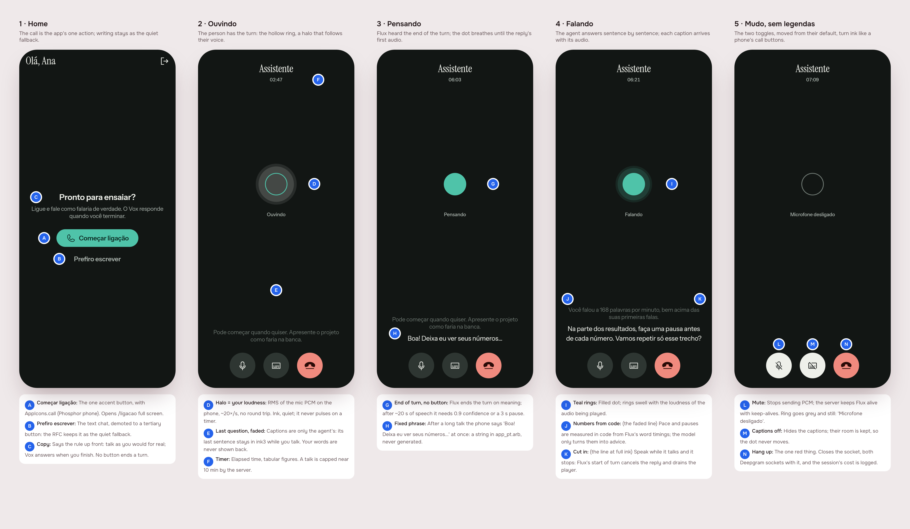
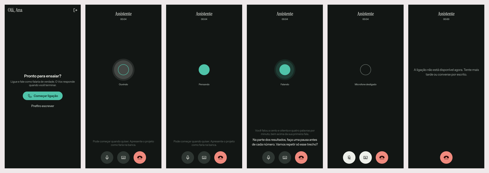

# A call with the agent, streamed through Deepgram

2026-10-31 · delivery · track: **mockup** · ships rollout phases 0 and 1 ·
from the RFC [*Stream the call through Deepgram, measure in code, coach with the model*](../../research/2026-10-30-voice-pipeline/README.md)

## 1. The prompt

Issue [#3](https://github.com/pietroid/vox/issues/3), *Implement: Stream the
call through Deepgram, measure in code, coach with the model*:

> Build what the RFC [product/research/2026-10-30-voice-pipeline/README.md](https://github.com/pietroid/vox/blob/main/product/research/2026-10-30-voice-pipeline/README.md) recommends, approved in #1 and merged in #2.
>
> - Read it as the research (see "From an RFC" in the /create skill): what it recommends, in its priority order, and its Rollout are the spec.
> - A `> **Decision**` note in it is binding; every other decision takes the option marked *(recommended)*.
> - The plan (or the board, if it changes what the person sees) says which rollout phases this PR ships, Phase 0 first.

The RFC's binding decisions: phone first (iOS, Android); Deepgram **Flux
STT** and **Flux TTS** as two separate calls with our model in between; no
button ends a turn, Flux does (a long pause means "I'm done"); the call
screen from the design system is the main feature.

## 2. The design

**Track: mockup.** The RFC's first piece is the call screen, so the person
approves what they will see before anything is wired.



Drawn by the real app (`app/lib/voice_call_preview.dart`, five scenes) with
the widgets the build ships; pins in [`board.json`](board.json). Each screen
alone: [1](img/mockup-1.png) · [2](img/mockup-2.png) ·
[3](img/mockup-3.png) · [4](img/mockup-4.png) · [5](img/mockup-5.png).

### What this PR ships: the rollout phases

The RFC orders the work in *The change*; this delivery cuts it into phases:

| Phase | What | Ships here |
|---|---|---|
| **0 · Measure** | a 20-line script against the key: Flux TTS first-audio latency and how its pt voice sounds; Flux STT's end of turn on a long Portuguese talk; cost per turn in the server log | **yes, first** |
| **1 · The call** | the call screen; mic streamed as PCM with echo cancel; `wss /api/assistant/voice` relaying to Flux STT, `Configure` as a turn grows, cut-in; Flux TTS sentence by sentence; metrics in TypeScript; the model's reply streamed; WebSocket through nginx and the tunnel | **yes** |
| 2 · The material | the session plan built once from the person's slides or notes (cached prefix) | no: the app has no way to give it material yet; a follow-up issue |

### References

Drawn from known patterns, not browsed (no Mobbin session here):

- **The phone's own call screen** (iOS Phone, WhatsApp calls): round
  controls at the thumb, toggles turn light when on, hang-up the one red.
- **ChatGPT voice mode**: an abstract presence instead of a face, its
  motion driven by the voice's loudness; no button to end a turn.
- **Live captions** (Android Live Caption, FaceTime): the current line at
  full ink, the previous one fading.

### Decisions

| Pin | Decision | Why |
|---|---|---|
| A | The home's one accent action is **Começar ligação**, `AppIcons.call` (Phosphor `phone`), opening `/ligacao` full screen | the call is the product; the RFC centres on it |
| B | The text chat becomes **Prefiro escrever**, a tertiary button | the RFC keeps it as the quiet fallback |
| C | Home copy states the rule: talk for real, Vox answers when you finish | no button ends a turn, so the person must know |
| D | The listening halo follows the mic's loudness (RMS on the phone, ~20×/s), in ink | "a halo follows your voice"; no round trip; never a timer |
| E | Captions are only the agent's; its last sentence stays faded while you talk | the design system's rule: speech going by, not a transcript |
| F | Title *Assistente* and the elapsed time, tabular figures | as the design system draws it |
| G | Pensando = from Flux's end of turn to the first audio; the dot breathes | the screen's states are the pipeline's events |
| H | After a long talk the phone says a fixed **"Boa! Deixa eu ver seus números…"** (`callAcknowledge`) | time to first audio; never generated |
| I | Falando: filled dot, teal rings follow the played audio's loudness | the design system |
| J | Feedback cites numbers measured in code (pace, pauses) against the person's own first takes | measure with code, judge with the model |
| K | Speaking over the agent stops it (Flux start of turn cancels the reply) | as on a call |
| L | Mute stops the PCM; the ring goes grey and still, *Microfone desligado*; Flux kept alive | the RFC; a still ring says nobody is heard |
| M | Captions off hides them but keeps their room | the dot never moves while you look at it |
| N | Hang up: the one red control; closes both Deepgram sockets, logs the session cost | the RFC |

**New in the design system** (`app_ui`): `AppPresence` (listening,
thinking, speaking, muted; `level` 0–1), `AppCallControl` (+ `.hangUp`), the
icons `call`, `microphone`, `microphoneOff`, `captions`, `captionsOff`,
`hangUp` (Phosphor fill `phoneDisconnect`), and the token
`AppSpacing.callCaptions` (120, the room kept for captions). Nothing generic
"AI": the presence is the dot from the mark.

## 3. What was built



The real `CallPage` and `CallCubit` over a scripted call (fake socket, mic
and speaker); every state on screen came through the cubit, not seeded.
Each alone: [1](img/build-1.png) · [2](img/build-2.png) ·
[3](img/build-3.png) · [4](img/build-4.png) · [5](img/build-5.png) ·
[6](img/build-6.png). The timer reads 00:04 because the shots are taken four
seconds into each call.

### Phase 0: what Deepgram did against the key

`server/scripts/deepgram-probe.mjs`, on the RFC's two synthetic takes
(`code/make_samples.sh`, macOS voice Luciana, 16 kHz).

**Flux TTS, pt-BR.** Two sentences, `linear16` 24 kHz:

| Voice | Connect | First audio after `Speak` |
|---|---|---|
| `flux-bianca-pt` | 637 · 610 ms | 283 · 252 ms |
| `flux-mariana-pt` | 408 ms | 190 ms |
| `flux-bruno-pt` | 383 ms | 191 ms |
| `flux-rodrigo-pt` | 377 ms | 189 ms |

Audio starts after a `Speak` without waiting for `Flush` (first bytes at
254 ms), and `Interrupt` stops it. Bianca's audio, fed back into Flux STT,
came back word for word, except that two `Speak` messages joined as
"minuto.Agora" were read as **"minuto ponto"**: Flux adds no space between
messages, so every sentence is now sent with a trailing one. Latency is
well under the RFC's estimate; the voice is understood by Flux, but **no
person has listened to it yet** (the WAVs are in `/tmp/vox-probe-*.wav` on
the Mac).

**Flux STT, end of turn.** The paced take (106 words, 0.9 s pauses between
sentences) streamed in real time:

| `eot_threshold` / `eot_timeout_ms` | Turns Flux made of one talk | Ended by |
|---|---|---|
| 0.7 / 5000 (defaults) | **6**: at 19.6, 29.7, 36.1, 45.4, 50.9, 53.0 s | meaning |
| 0.8 / 3000 | 3 | meaning |
| 0.9 / 3000 and 0.9 / 2000 | 3 | meaning (confidence 0.92 at a sentence end) |
| 1.0 / 3000 | **1** | silence, 3 s after the last word |
| 0.7, `Configure` 0.9 + 3 s at 20 s (the RFC's plan) | 6 (the first cut came at 19.6 s, before the switch) | meaning |

The rushed take (no pauses) stayed one turn under the RFC's plan. On a short
answer (two sentences), 0.7 ends 0.5 s after the speech, 0.9 1.4 s after,
1.0 3 s after. So **the RFC's long-turn rule would have cut a paced talk**,
and the build changes it: a turn starts at the defaults (short answers end
fast), and **after 10 s of speech only 3 s of silence ends it** (`eot_threshold`
1.0). A turn Flux still ends early is merged with the next one when the
agent hasn't spoken yet. No button was needed.

### A whole call, end to end

`server/scripts/voice-e2e.mjs` drives a `VoiceSession` with the real Flux
STT, Flux TTS and OpenRouter (`anthropic/claude-haiku-5.5`), the rushed
take then the paced one streamed as the mic. The second run, abridged:

```
  0.89 caption "Oi, Ana! O que você quer treinar hoje?"         (first audio 861 ms)
  4.15 --- streaming rushed.wav
 11.71 state thinking   11.99 state listening                    (an early end, merged back)
 40.25 --- take ended, silence
 43.78 state thinking                                            (3 s silence + ~0.5 s)
 43.79 take measured: wpm 184, pauses 6, longest 0.36 s, pause share 0.06, pitch 188 Hz, spread 4.4 st
 43.90 caption "Boa! Deixa eu ver seus números…"                 (0.1 s after the turn ended)
 49.87 caption "Ana, essa foi a primeira fala longa da ligação, então ela serve de referência."
 63.90 caption "O ponto a mudar é o ritmo, que ficou em cerca de cento e oitenta e quatro palavras por minuto."
 66.42 interrupt                                                 (the next take started over it: cut-in)
124.51 take measured: wpm 121, pauses 9, longest 1.18 s, pause share 0.18, pitch 188 Hz, spread 4.2 st
131.93 caption "Na primeira fala você estava em cerca de cento e oitenta e quatro palavras por minuto,
               e agora está em cento e vinte e um, com pausas mais longas, a maior de um segundo e dezoito."
146.96 call ended: 2 turns, 142 s heard, 641 chars spoken, $0.0480
```

The measured numbers match the RFC's Python script on the same audio
(`data/takes.jsonl`: 180/118 wpm, 6/9 pauses, 0.36/1.18 s longest,
0.06/0.18 share, 190 Hz, 4.4 st); pace differs by 3 wpm because it is
counted on Flux's words. The first run's coach called a Flux mishearing
("Heido há semanas") the person's mumbling; the prompt now says the
transcription can swap words, and in the second run it said so instead.
$0.048 for 2.4 minutes is in line with the RFC's 18¢ per 10 minutes.

The gateway, on a locally running server: a foreign `Origin` gets HTTP 403;
no token and a wrong bearer both get close **4401** *"Entre de novo para
ligar."*.

### The contract

**One socket per call; Flux ends turns, never a button; the screen's states
are the server's events.** `wss /api/assistant/voice`, signed in on the
upgrade (bearer on the phones, cookie plus a matching `Origin` on the web):

| Direction | Message |
|---|---|
| phone → server | binary PCM16 16 kHz mono; `{type:'mute', muted}` |
| server → phone | `{type:'state', state}` listening · thinking · speaking; `{type:'caption', text}` before its audio; binary PCM16 24 kHz; `{type:'interrupt'}` |
| close codes | 4401 not signed in · 4503 no voice here · 1011 dropped · 4000 the 30-minute cap |

Full rules in [`product/spec/voice-call.md`](../../spec/voice-call.md).

### Server (`server/src/assistant/voice/`)

- `voice.gateway.ts`: the upgrade on Nest's own HTTP server (`ws`, no
  `@nestjs/websockets`), Better Auth's session check, the origin check, one
  `VoiceSession` per socket, one `voice_call` analytics event at the end
  (seconds, turns, chars, USD; no words).
- `voice-session.ts`: the call. Relays the mic to Flux and to `VoiceTrack`;
  muted, feeds Flux 80 ms of silence every 80 ms (Flux STT has no
  keep-alive message); the turn rule above; measures takes (≥ 15 s) and
  keeps the first as the reference; the fixed acknowledgement after a talk
  ≥ 20 s; streams the model, one Flux TTS turn per sentence so each
  `SpeechStarted` marks where its caption goes; cut-in closes the TTS
  socket and opens a fresh one (Flux's `Interrupt` can race a sentence that
  just ended); logs each turn's time to first audio and cost; a 10-minute
  talk cap (`ForceEndTurn`) and a 30-minute call cap.
- `deepgram.ts`: Flux STT (`flux-general-multi`, `language_hint=pt`) and
  Flux TTS (`flux-bianca-pt`) over `ws`, behind `VoiceVendor`.
- `speech-metrics.ts`: the port of `speech_metrics.py`, pitch measured as
  the audio arrives (every other 10 ms hop, on loud frames only: ~150 ms of
  work per minute of talk on the Mac, spread over the call).
- `coach.ts`: the call's system prompt, the turn message with the numbers,
  the sentence splitter (drops markdown, which Flux would read aloud).
- `OpenRouterClient.stream`: the reply as server-sent events, abortable.
- `deploy/nginx.conf`: a location that upgrades `/api/assistant/voice`,
  35-minute timeouts. `DEEPGRAM_API_KEY` in `.env.example` and `SETUP.md`.

### App (`app/packages/call/`)

- `CallCubit` over a `CallService` (the socket, the mic, the speaker);
  `ServerCallService` in `main.dart`. A 50 ms ticker moves the timer, the
  halo and a `PlaybackClock` that queues the received voice and captions on
  one timeline, so a caption shows when its audio starts and Falando lasts
  while the phone still plays.
- `RecordMicrophone` (`record`, PCM16 16 kHz, echo cancel and noise
  suppression, Android's voice-communication source), `PcmVoicePlayer`
  (`flutter_pcm_sound`, iOS `playAndRecord`), `SocketVoiceLine`
  (`web_socket_channel`, bearer token).
- New phase **microphoneDenied** with `callMicrophoneDenied`;
  `NSMicrophoneUsageDescription` and `RECORD_AUDIO`.

### Tests

- Server, 21 new (`npm test`): metrics on Flux's real word timings of both
  takes and on synthetic audio (pauses, long pauses, an "é…", pitch the
  same whatever the chunk size); the splitter; the session over fake
  Deepgram and model (greeting, sentence by sentence with captions,
  measuring and the reference, the long-turn `Configure` and its reset, the
  talk cap, cut-in keeping what was heard, merging an early end, the
  apology when the model fails, silence while muted, hang-up and cost,
  Deepgram dropping).
- App, 13 new in `packages/call` (clock, cubit over fakes, page), and the
  home's test updated to the call-first home.

### Where the build differs from the mockup

- **The long-turn rule**: 1.0 + 3 s after 10 s, not 0.9 + 3 s after 20 s
  (pins C, G), from the Phase 0 table above.
- **The acknowledgement is said by the server in the agent's voice**, not
  by the phone's TTS (pin H): one voice on the call, no `flutter_tts`, and
  it's on air 0.1 s after the turn ends. It shows as Falando with its
  caption, not as Pensando; `callAcknowledge` left the ARB.
- **The agent greets first** ("Oi, Ana! O que você quer treinar hoje?"),
  so the call opens with a voice and its caption.
- **The web build doesn't call**: the RFC put the phones first and the
  player plugin is the phones'; on the web the screen says the call isn't
  available (scene 6's text).
- **Coaching on the person's material** (the RFC's session plan) is not
  here: rollout phase 2, a follow-up issue.

### Not tested

- **No real phone has made a call.** The app was built for web prints and
  tested over fakes; the mic, the player and above all **echo
  cancellation** (whether the agent's voice, on the speaker, triggers a
  cut-in) are unverified on iOS and Android. On iOS, `record` and
  `flutter_pcm_sound` each set up the audio session; that they share it
  well is the first thing to check.
- The voice through nginx and the Cloudflare tunnel (no deploy from here).
- A real person's speech: every take was synthetic. The 10 s and 3 s are
  set from these; the first real talks should confirm them.

### Decided unattended

- The turn rule above, against the RFC's 0.9 + 20 s: its own text says the
  values are "tuned by the first test against your key".
- The fixed acknowledgement moved to the server's voice.
- Voice `flux-bianca-pt` (female, Brazil): its latency was the highest of
  the four (250–280 ms vs ~190 ms) but well under budget; a one-line change
  in `deepgram.ts` (`VOICE`) once someone listens.
- Reasoning `exclude: true` on the streamed call, so no thinking text is
  spoken; the effort stays `OPENROUTER_REASONING`.
- An early Flux end flickers Pensando for ~0.3 s before the merge (seen at
  11.7 s above); left as is.

## 4. How to turn it on

- `DEEPGRAM_API_KEY` in `server/.env.local` (and the Pi's `/opt/vox/.env`),
  with `OPENROUTER_API_KEY` and `OPENROUTER_MODEL`. Without them the socket
  closes 4503 and the screen says *"A ligação não está disponível agora."*;
  the chat works.
- Deploy as usual: the new nginx location ships in `vox-web`.
- On a phone: `flutter run --flavor dev --dart-define-from-file env/dev.json`,
  Começar ligação, allow the mic.
- To measure again: `node --env-file=.env.local scripts/deepgram-probe.mjs tts|stt …`
  and `npm run build && node --env-file=.env.local scripts/voice-e2e.mjs take.wav`
  (in `server/`).

## 5. Cost and time

Measured by the queue: see the pull request.

Outside Claude: Deepgram and OpenRouter calls during the build, about
**$0.15** (two end-to-end calls at ~$0.05, eleven STT probes of ~1 minute,
five TTS probes), from the session logs and the price list, on the
person's key and its free credit.
