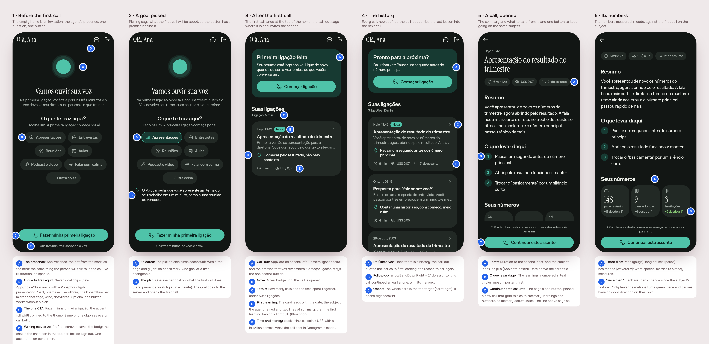
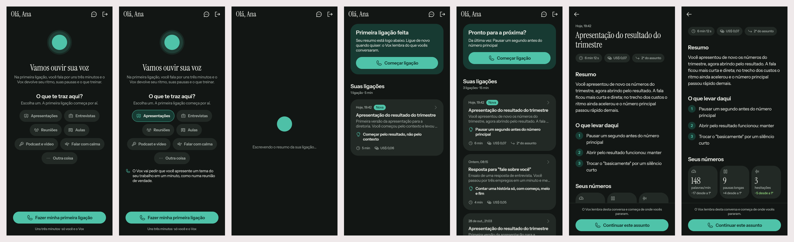

# The first call, then the history of calls

2026-11-01 · delivery · track: **mockup**

## 1. The prompt

Issue [#5](https://github.com/pietroid/vox/issues/5), *Create an onboarding
and a history of calls*:

> Create an attractive onboarding experience. From until the user signs up until the moment the user does the first call, there should be a nice empty screen engaging the user to do his first call and asking what brings the user there.
>
> After the first call ends, it appears on the first page in the history of calls, with content summary and the learnings. It should show the date, how much the user spent (in $) and in time too. When clicking on it, it should open with more details about the summary of it, and have a button to call again and follow up on that subject (so the memory accumulates)
>
> Make a good design with good iconography, great calls to action, etc. Make it shine.

## 2. The design

**Track: mockup.** It's all about what the person sees: the empty home, a
history on the home, and a page for each call.

Drawn by the real app (`app/lib/call_history_preview.dart`, six scenes)
with the widgets the build will ship; pins in [`board.json`](board.json).
Each screen alone: [1](img/mockup-1.png) · [2](img/mockup-2.png) ·
[3](img/mockup-3.png) · [4](img/mockup-4.png) · [5](img/mockup-5.png) ·
[6](img/mockup-6.png).

### The flow

1. **Before the first call** the home is an invitation: the agent's
   presence (the dot from the mark), *Vamos ouvir sua voz*, the question
   *O que te traz aqui?* with seven goal chips, and one button,
   *Fazer minha primeira ligação*.
2. **Picking a goal** shows one line on what the first call will do about
   it. The goal is optional: the button works without it.
3. **After the first call** the home becomes the history: a call-out
   (*Primeira ligação feita*) with *Começar ligação*, then *Suas ligações*
   with the call's card, marked *Nova*.
4. **The history**: every call, newest first. Each card shows the date, the
   subject, two lines of summary, the first learning, the minutes, the cost
   in US$, and *2ª do assunto* when it follows up an earlier call. The
   call-out quotes the last call's first learning (*Da última vez: …*).
5. **A call, opened** (`/ligacoes/:id`): the date, the subject as a
   heading, the facts as pills (time to the second, cost, subject index),
   *Resumo*, *O que levar daqui* (numbered), *Seus números*, and one button
   pinned at the foot, *Continuar este assunto*.
6. **Its numbers**: pace, long pauses and hesitations, the numbers
   `speech-metrics.ts` already measures, each with its change since the
   subject's first call.

### References

Drawn from known patterns, not browsed (Mobbin needs a login, and no
browser was connected to this unattended run):

- **Duolingo / Headspace onboarding**: one question with tappable answers
  before the first lesson, and a line saying what the first session will
  be like, so the first tap has a promise behind it.
- **Granola / Otter meeting history**: a list of sessions, each card
  carrying the AI's title, a gist and the facts, the detail opening into
  summary and action items.
- **Strava activity detail**: a few big numbers in tiles with the change
  against a baseline, under the story of the activity.

### Decisions

| Pin | Decision | Why |
|---|---|---|
| 1A | The hero is `AppPresence` (the brand's dot, speaking), not an illustration | The person meets what they'll talk to; no generic AI art |
| 1B, 2A | Seven goal chips (new `AppChoiceChip`), one at a time, optional | One tap, no typing; skipping must not block the first call |
| 1C, 3A, 5C | One accent button per screen, full width, with `AppIcons.call` | Every call starts from the same glyph and colour |
| 1D | *Prefiro escrever* moves to a chat icon (`AppIcons.assistant`) in the top bar | Keeps one accent action in the body; the chat stays a tap away |
| 1E | *Uns três minutos · só você e o Vox* under the first button | Says how long and that nobody else listens, the two worries before a first call |
| 2B | One sentence per goal on what the first call does | The goal changes the call, and the person sees how |
| 3B | *Nova* badge until the call is opened | Points at the first card right after the call ends |
| 3D | The card leads with the first learning, behind `AppIcons.learning` (Phosphor lightbulb) | The learning is why the history is worth opening |
| 3E | Cost as *US$ 0,07* (`coins`), time as *6 min* (`clock`) | The issue asks for both; the Brazilian comma, dollars because that's what the calls cost |
| 4A | The call-out quotes *Da última vez: …* | Carries the last lesson into the next call |
| 4B | *2ª do assunto* with `arrowBendDownRight` | Shows which calls continue a subject, so memory is visible |
| 5A | Duration to the second on the detail, minutes on the card | Precise where there's room, scannable in the list |
| 5C | *Continuar este assunto*, pinned, with *O Vox lembra desta conversa…* above | The follow-up is the page's one action, and the line says what it does |
| 6B | Only fewer hesitations turns green | Pace and pauses have no good direction on their own |

New icons (all Phosphor regular, named in `AppIcons`): `back`, `chevron`,
`duration`, `cost`, `followUp`, `learning`, `pace`, `pauses`,
`hesitations`, and `goalPresentations`, `goalInterviews`, `goalMeetings`,
`goalTeaching`, `goalRecording`, `goalCalm`, `goalOther`. No new brand SVG.

### Decided unattended

- **Track: mockup**, six scenes (the sixth is the detail scrolled to its
  numbers, which sit below the fold on a 390×844 phone).
- **The goal is optional.** The first-call button is enabled before a pick:
  a question that blocks the first call costs more than it tells.
- **Writing moves to the top bar** (chat icon) on both homes, instead of a
  second button under the call.
- **Cost is shown in US dollars** as the issue says, not converted to reais.
- **"Follow up" means a new call that starts with the earlier calls on the
  subject as memory** (their summaries, learnings and numbers in the
  model's context), not one growing call.
- **The history is the home**, not a separate tab: the app has one screen
  today, and the issue says "on the first page".

## 3. What was built

These are the real widgets, cubit and route over a fake repository. The
preview entry point was deleted afterwards. Scenes:
[1](img/build-1.png) first run · [2](img/build-2.png) goal read back ·
[3](img/build-3.png) *Escrevendo o resumo da sua ligação…* ·
[4](img/build-4.png) after the first call · [5](img/build-5.png) the
history · [6](img/build-6.png) a call opened by id (`CallDetailRoute`) ·
[7](img/build-7.png) its numbers.

### The contract

**The audio and the transcript are never stored.** When the call's socket
closes, the server keeps a call only if the person was answered at least
once. The model writes `{ title, summary, learnings }` once, from the
conversation and the numbers. Only those notes, the numbers summed from the
takes, the time and the cost go into Postgres. A follow-up
(`?follows=<id>`) tells the coach the subject's last 3 calls. Full
contract: [product/spec/call-history.md](../../spec/call-history.md).

### Server (`server/src/calls/`, a Nest module)

| Route | What it does |
|---|---|
| `GET /api/calls` | `{ goal, calls }`, newest first, each call's metric deltas against the subject's first call |
| `GET /api/calls/:id` | one call; 404 *Essa ligação não foi encontrada.* |
| `POST /api/calls/:id/seen` | 204, marks the call as opened (`call_opened` in PostHog) |
| `PUT /api/users/me/goal` | 204; 400 *Objetivo inválido.* (`goal_chosen`) |

- Tables `call` and `user_goal` (`drizzle/0001_calls.sql`). Better Auth's
  `user` table is left untouched.
- `call.store.ts`: the `CallStore` interface, `DrizzleCallStore`, and
  `InMemoryCallStore` for the specs. Every query is scoped to the user's id.
- `call-summary.ts`: the notes prompt and a strict parser (fences tolerated,
  title ≤ 80 chars, 1–3 learnings), the memory prompt (days written in
  São Paulo time, never the server's zone), and the call's numbers summed
  from its takes.
- `calls.service.ts`: `history`, `one`, `markSeen`, `setGoal`, `brief`
  (what a call opens with) and `record` (what is kept when it ends). If the
  model fails, the call is still kept, with a fixed title and no learnings.
- `voice.gateway.ts` reads `?follows=`, asks for the brief before the
  session starts, and calls `record` on close. `VoiceSession` takes the
  brief (memory in the prompt; on a follow-up the greeting is *Vamos
  continuar de onde paramos?*) and exposes `conversation` and `takes`.
  `coachPrompt(user, memory)`.
- `speech-metrics.ts` now also counts hesitations (`hesitations`), not
  only their seconds, because the page shows a count.

### App

- `packages/call_history`: `CallHistoryRepository` and
  `ApiCallHistoryRepository`; `CallHistoryCubit` (`load`, `chooseGoal`,
  `markSeen`, and `afterCall`, which reads the history every 2 s, up to 8
  times, until the new call appears); `CallRecord.fromJson`;
  `SpeakingGoal.fromKey`.
- `lib/home/home_page.dart`: `startCall` and `openCall`, plus loading,
  failed (with *Tentar de novo*) and summarizing states.
  `lib/home/call_detail_route.dart`: `/ligacoes/:id`, which takes the call
  from the home or reads it by id.
- `packages/call`: `CallPage(follows:)`, `CallCubit.follows` and
  `.connected`, `CallService.dial(follows:)`. Hanging up pops whether the
  call got through, so a call that never connected doesn't trigger the
  summarizing wait.
- Strings: added `homeNextBody`, `historySummarizing`, `historyLoadFailed`,
  `historyRetry` and `callLoadFailed`. Removed the five unused strings the
  brief named.

### Tests

`.tool/check` passes: app analyze, every touched package, server eslint,
tsc and tests.

- Server: 58 tests in 8 suites. New ones: `calls.service.spec.ts` (keeping,
  nothing kept without a turn, model failure, the follow-up's subject index
  and deltas, someone else's call ignored, the goal in the brief, scoping
  per user, goal refusals), `call-summary.spec.ts` (parsing, the 3-call
  cap, São Paulo days), a follow-up case in `voice-session.spec.ts`, and a
  hesitation count in `speech-metrics.spec.ts`.
- `call_history`: 18 tests (cubit, JSON, `CallFormat`, `GoalPicker`,
  `CallCard`, `CallDetailPage`).
- `call`: 15 tests (3 new: dialing with `follows`, the socket URL,
  `connected`).
- App: 8 tests (the home's first run and its history).
- No flaky test was seen.

### Where the build differs from the design

- **No `?goal=` on the socket.** The goal is saved with
  `PUT /users/me/goal` the moment it's picked, and the server reads it for
  every call's brief. One source, and later calls also remember why the
  person came. The cost: if saving the goal fails, the first call just
  doesn't know it.
- **Two states the board didn't draw**: *Escrevendo o resumo da sua
  ligação…* (scene 3, and as a card on top of the history), because the
  notes take a few seconds after hang-up; and loading/failed states for the
  history and the detail.
- **The follow-up starts from the home.** *Continuar este assunto* pops
  back to the home, which dials and then reloads the history. On a detail
  opened directly (a web reload) it dials straight from there.
- **The cost includes the notes**: the call's Deepgram and model turns,
  plus the one model call that writes the summary.

### Decided unattended

- An unknown or foreign `?follows=` id **starts a fresh call** instead of
  refusing it: the person still gets a call. It never reads another
  person's call.
- A call in which the person was never answered **isn't kept**.
- A follow-up's memory is capped at the **last 3 calls** on the subject.
- Calls are kept forever and can't be deleted. Deletion was left out, as
  in the design (open question below).

### Not tested

- **Never run against the real Deepgram, OpenRouter or Postgres.** The
  notes prompt has not been seen answering from a real model. The parser
  tolerates fences and refuses anything without a title and a summary. The
  migration was generated by drizzle-kit and not applied to a database
  here.
- Not tried on a phone. The `?follows=` socket URL is covered by a unit
  test only.

### Open questions

- Should a person be able to **delete** a call from the history?
- The cost shown is **what the call cost Vox**. If Vox later charges a
  price of its own, this should become that.

## 4. How to turn it on

Nothing new to set. The migration `0001_calls` runs on server boot. The
history needs the database the server already has. The notes and the call
need `OPENROUTER_API_KEY`, `OPENROUTER_MODEL` and `DEEPGRAM_API_KEY`, as
before. Without them there are no calls, so the home stays the first-run
invitation. If only the notes fail, calls are kept without a summary.

## 5. Cost and time

Measured by the queue: see the pull request.

Outside Claude, the build caused no spend. Nothing called OpenRouter or
Deepgram; every test ran against fakes. In production, each kept call adds
one model call for its notes, and that cost is included in the call's own
US$.
