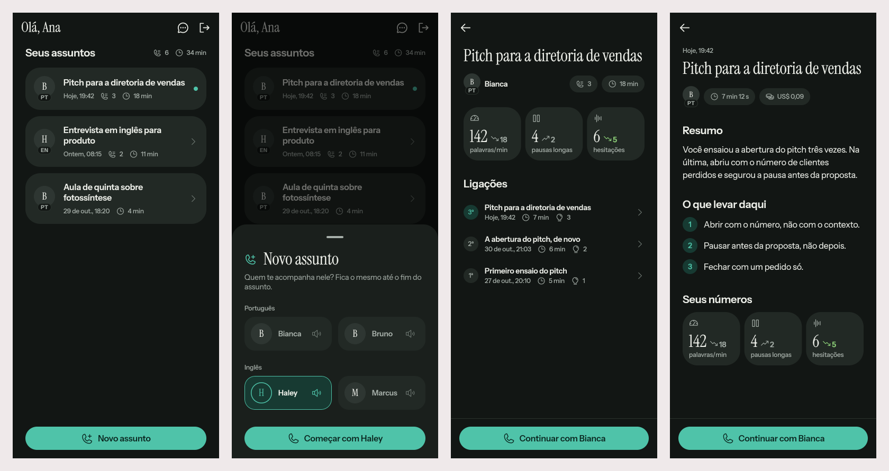

# Coaches in Portuguese and English, and the home by subject

2026-11-01 · delivery · track: **mockup**

## 1. The prompt

Issue [#7](https://github.com/pietroid/vox/issues/7), *Add support to PT BR and EN*:

> When you start a new call you can select multiple "assistants", male and female pt br or en (4 at total)
>
> This assistant will be coaching you in that specific thread.
>
> The page actually groups the list by threads, it shows the latest call on that subject and when you tap you can see the history of past calls in that same subject. There could be some stats as well.
>
> Make the "new" call more clear that it will create a new subject
>
> Does not fill the page with more heavy text information, remove whenever necessary, and replace by icons whenever you can.

Then, in the session that finished it, after the queue's design run ran out of usage:

> I have prioritized https://github.com/pietroid/vox/issues/7 and I have charged 5 dollars of my claude so you can finish this task, please take the context on the queue of the existing session, continue it, and then close the PR after everything solved

So the design gate was not stopped at: the design and the build went
straight on to the merge.

## 2. The design

**Track: mockup.** The queue's design run (`417464f5`) drew the screens
in Flutter (the coach picker, the home by subject, a subject's page, a call
restyled with glyphs) and stopped on the usage limit during its one round of
fixes. No board was laid out. The prints of the finished build are in
section 3.

References: no apps were browsed. The picker borrows the voice picker of
ChatGPT's voice mode (a few named voices with a sample button), and the
subject list the thread list of Messages/WhatsApp (avatar, title, last
activity, an unread dot).

| # | Decision | Chosen | Why |
|---|---|---|---|
| A | Who the coaches are | **Bianca** and **Bruno** (PT), **Haley** and **Marcus** (EN), each named after the Flux TTS voice they speak with | The name you pick is the voice you hear. Every call before this had Bianca. |
| B | Where you pick | A sheet, *Novo assunto*, opened by the only button on the home (`phonePlus` icon), pre-set to the last coach used | The button says it starts a *new subject*. Following up a subject never asks again. |
| C | The coach stays with the subject | Picked on the first call, kept on every follow-up (server-side) | "This assistant will be coaching you in that specific thread." |
| D | The home | *Seus assuntos*: one card per subject, the newest first: avatar with a PT/EN tag, latest title, and glyphs for the day, number of calls and total time. A teal dot means a call hasn't been opened | Grouped by thread, with less text. The old call-out and its sentences are gone. |
| E | A subject, opened | `/assuntos/:id`: the title, the coach, calls and time as boxed glyphs, the latest numbers with trend arrows since the first call, the calls (*1ª, 2ª, 3ª…*), and *Continuar com Bianca* pinned at the foot | The history of past calls on the subject, with stats |
| F | Text replaced by glyphs | "−17 desde a 1ª" became `↘ 17`. The call page's follow-up note and *Nª do assunto* pill are gone | "Replace by icons whenever you can" |

## 3. What was built

*(Drawn from the real widgets against fakes. The preview passes the sample
button, which the shipped app hides until coaches have voice samples.)*

**The rule that matters:** a subject's coach is fixed by its first call.
`?coach=` on the call's socket is read only for a new subject; a
`?follows=` call takes the coach of the call it follows, whatever the app
sends.

**Server**
- `src/calls/coaches.ts`: the four coaches (name, Flux TTS voice,
  language, role); `coachOf(key)` falls back to Bianca.
- Table `call` gets `coach text not null default 'bianca'`
  (`drizzle/0002_call_coach.sql`). Older calls read as Bianca.
- `CallsService.brief(user, follows, coach)` answers the coach;
  `record` stores it. `CallView` now carries `coach` and `subjectId`.
- `voice.gateway.ts` reads `?coach=` and passes the coach to the session.
  Analytics' `voice_call` gets `coach` (a key, nothing personal).
- `VoiceVendor.listen(…, language)` hints Flux STT (`flux-general-multi`,
  `language_hint=en|pt`); `speaker(…, voice)` picks the TTS model.
- `coach.ts`: `coachPrompt(user, memory, coach)` names the coach and,
  for English, tells the model to answer only in English. `greeting()`
  gives the first sentence in the coach's language.
- The call's notes (title, summary, learnings) stay in Portuguese, since
  the whole app is in Portuguese.

**App**
- `call_history`: `Coach`/`CoachLanguage`, `CallSubject` (grouping, totals,
  latest numbers), the views `CoachPicker`, `SubjectCard` and `SubjectPage`.
  `CallRecord` reads `coach` and `subjectId` (older servers: Bianca, its
  own subject).
- `app_ui`: `AppAvatar` (initial with a language tag) and `AppStat` (a
  number with a trend arrow), icons `newSubject`, `calls`, `listen`,
  `trendUp`, `trendDown`, tokens `avatar`, `avatarLarge` and type `tag`.
- `call`: `CallPage(coach:)` → `CallCubit` → `dial(coach:)` →
  `?coach=`.
- Router: `/assuntos/:id` (`lib/home/subject_route.dart`, which reads the
  history after a reload on the web), and `/ligacao?coach=`.

**Tests:** server 62 (new: a subject keeps its coach on follow-ups, an
unknown coach starts as Bianca, the session's language, voice, greeting and
prompt for Haley, and Bianca by default). App: `call_history` 23 (new:
grouping, `fromJson` with and without a coach, the picker, the subject
page), `call` 15 (the `?coach=` URI), app 8. `flutter analyze` and eslint
are clean. No flaky tests.

**Voices checked against Deepgram** (`scripts/deepgram-probe.mjs tts` and
a socket probe): `flux-bianca-pt` (first audio 190 ms) and `flux-bruno-pt`
(258 ms) speak, and `flux-haley-en` and `flux-marcus-en` open. The design
had picked `flux-thalia-en` and `flux-apollo-en`, which Deepgram rejects
("No such model/version combination"), so the English coaches became Haley
and Marcus.

**Where the build differs from the design**
- The English coaches were renamed to Haley and Marcus (above).
- The picker's sample button is in the widget (`onListen`), but the
  home doesn't pass it yet. There are no recorded samples, and synthesising
  one per tap would cost a TTS call each time.
- The old `CallCard` stays in the package, tested but unused by the home.

## 4. How to turn it on

Nothing new: the migration runs on boot, and the same `DEEPGRAM_API_KEY` and
OpenRouter settings serve all four voices. Without them the call closes
4503, as before.

**Not run:** a whole call with an English coach against the real model
(`scripts/voice-e2e.mjs`). The pieces were tested separately.

## 5. Cost and time

| Session | Time | USD |
|---|---|---|
| Queue design run `417464f5` (stopped by the usage limit) | 8 min | 1.85 |
| This session: picking up, the build, prints, delivery, merge | ~25 min | ~3.0 (usage-bars, before the merge) |
| **Total** | ~33 min | **~4.85** |

USD comes from the queue's record and from usage-bars, and includes the
talk around the work. The voice probes cost a few seconds of Deepgram TTS
(negligible). No OpenRouter calls were made.
