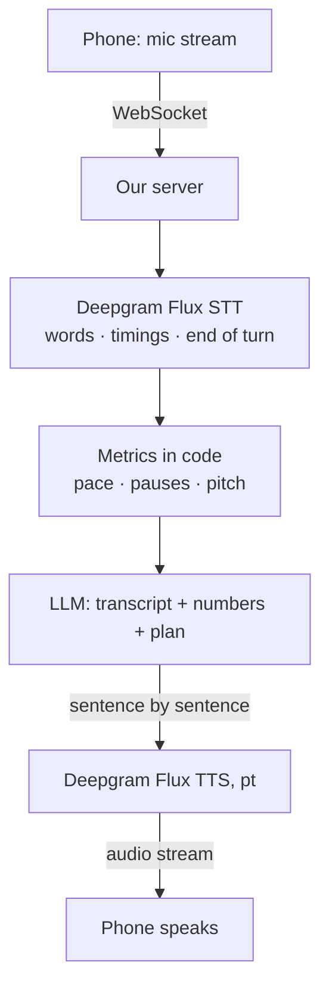
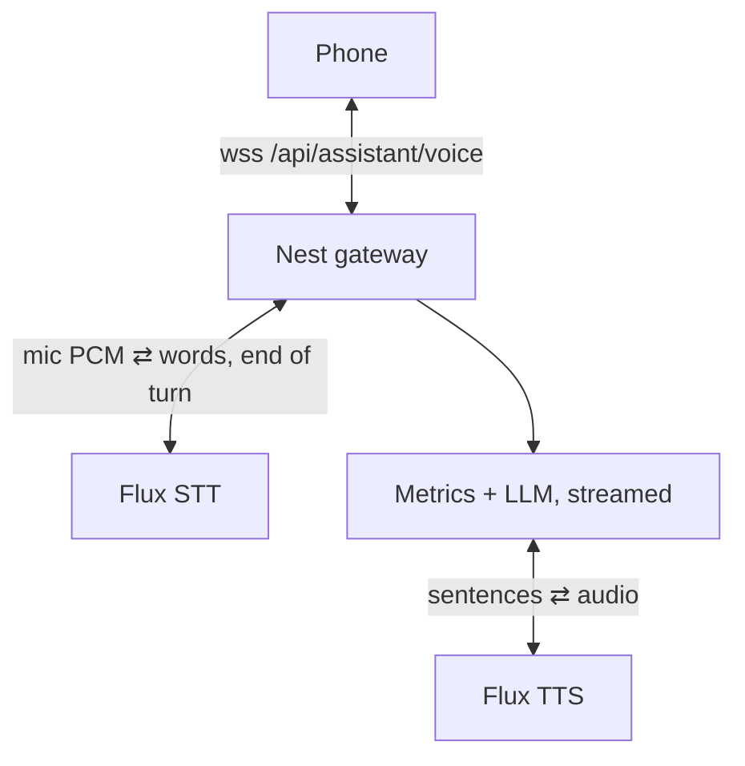
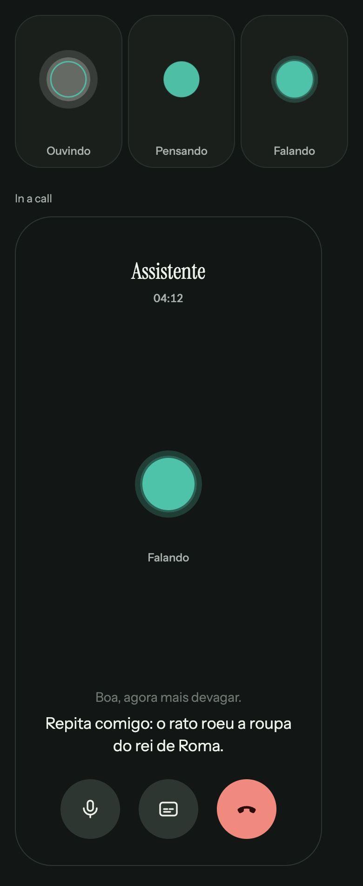
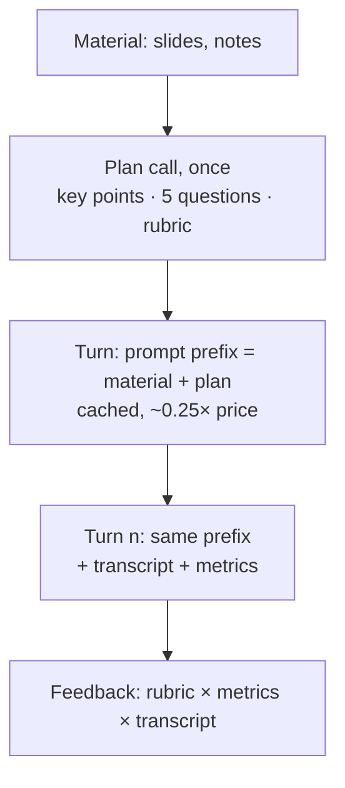

# Stream the call through Deepgram, measure in code, coach with the model

2026-10-30 · RFC · revised 2026-10-31 after review · the voice loop of a practice session on the phone: STT, speech metrics, the agent, TTS

## Stream both ways through Deepgram; keep the numbers in code

> [!IMPORTANT]
> The phone streams the microphone to our server, which relays it to
> **Deepgram Flux STT** (Portuguese, word timings, end-of-turn detection).
> Pace, pauses and pitch are computed in plain code, the model gets the
> transcript, the numbers and a plan built once from the material, and its
> reply streams sentence by sentence into **Deepgram Flux TTS**, the only
> Deepgram voice that speaks pt-BR. About **18¢ per 10-minute session**,
> a fifth of a realtime model, with the turn-taking of a call.

- **Do:** phone first; one WebSocket per session; Flux STT and Flux TTS as
  two separate calls; metrics as code; a session plan; stream the reply.
- **Not needed:** a realtime speech-to-speech model, Deepgram's all-in-one
  agent API, RAG, storing audio.
- **You decide:** Flux TTS or the phone's free voice; relay or direct.

> **Decision (2026-10-31):** "Phone is the prefered, and for more natural
> conversation lets go with the option of deepgram separated STT and TTS.
> I alerady have a deepgramkey so when building we can base off this."
> The RFC now targets iOS and Android first and uses Deepgram for both
> directions; Groq Whisper and the upload-per-turn protocol are dropped.

> **Note:** "Also consider this for the build phase:
> [the linked artifact](https://claude.ai/artifact/4McqUkEo4Y5hjGMjS9h5Gh)".
> Then (2026-10-31): "I have put the artifact inside the local repository
> on the machine as html".
>
> **A:** Read it: *Vox Design System*, take two, with the call screen
> designed. It is copied into this RFC as
> [`data/vox-design-system.html`](data/vox-design-system.html) so the build
> reads it from the repo. Two new slides follow
> [*End of turn*](#end-of-turn-is-a-calls-feature-and-a-rehearsals-trap):
> the screen, and the pipeline signal behind each thing on it.

## Today the assistant is text-only, blocking, and capped at 4 minutes

| What | Where | For a voice coach |
|---|---|---|
| Typed text only, no audio anywhere | [`assistant_page.dart:95`](../../../app/lib/assistant/assistant_page.dart#L95) | the core input is missing |
| One message ≤ 4,000 chars | [`assistant.controller.ts:25`](../../../server/src/assistant/assistant.controller.ts#L25) | a talk past **~4 min at 150 wpm** is refused ([data](data/transcript_fit.csv)) |
| The whole reply before any of it shows | [`openrouter.client.ts:149`](../../../server/src/assistant/openrouter.client.ts#L149), no `stream` | the wait is the full generation |
| Cost and cache hits read, then dropped | [`assistant.service.ts:48`](../../../server/src/assistant/assistant.service.ts#L48) | nobody sees what a session costs |
| A two-line generic prompt | [`assistant.service.ts:53`](../../../server/src/assistant/assistant.service.ts#L53) | no material, no plan, no rubric |

What already fits: the server keeps nothing and the app sends the whole
conversation each turn, so a richer turn (transcript + metrics) needs no new
storage; `usage.cachedTokens` is already parsed, ready for prompt caching.
There is no WebSocket anywhere yet: Nest, nginx and the Cloudflare tunnel
each need it switched on. None of the voice path has tests.

## Example: the same 104 words, rushed and paced

| | Rushed | Paced |
|---|---|---|
| Pace | **180 wpm** | 118 wpm |
| Time in pauses | 6% | **18%** |
| Longest pause | 0.36 s | 1.18 s |
| Analysis time, no API | 0.20 s | 0.30 s |

Two takes of a one-minute pitch, made with macOS `say` (pt-BR voice),
measured by [`code/speech_metrics.py`](code/speech_metrics.py): 150 lines of
numpy, loudness for pauses, autocorrelation for pitch. Deepgram's word
timings feed the same arithmetic. Tone is judged against the person's
**own** first takes, not a universal norm.

> [!TIP]
> **Measure with code, judge with the model.** Pace and pauses are
> arithmetic on timestamps; a model asked "was that rushed?" guesses.
> *For us:* the LLM gets `180 wpm, pauses 6%` and turns it into advice.

## The phone's free recogniser stops at the first long pause

| Free on-device option | Limit | Source |
|---|---|---|
| `speech_to_text`, iOS | "a one-minute limit on audio duration" | Apple, quoted on [pub.dev](https://pub.dev/packages/speech_to_text) |
| `speech_to_text`, Android | stops after a pause, "none … longer than 5 seconds" | same page |
| `flutter_tts` (speaking) | none that matters | [pub.dev](https://pub.dev/packages/flutter_tts) |

The package's target is "commands and short phrases, not continuous spoken
conversion". A rehearsal is minutes long and its pauses are what we
measure, so the phone can't transcribe it. It can **stream** it: the mic
goes out as 16-bit PCM over one WebSocket, with no time limit.

## Deepgram speaks Portuguese only through Flux TTS, not Aura-2

| Deepgram model | Portuguese | Price | Role here |
|---|---|---|---|
| **Flux STT, multilingual** | yes, `pt` | $0.0078/min streamed | listens: words, timings, end of turn |
| Nova-3 | yes, `pt-BR` | $0.0092/min streamed | fallback listener, no turn detection |
| **Flux TTS** | yes, `pt` (Brazil, Portugal) | $0.045/1k chars | speaks; WebSocket on `/v2/speak` |
| Aura-2 | **no**: 7 languages, none Portuguese | $0.030/1k chars | ruled out |

The first draft costed Aura-2; it can't speak pt-BR
([models](https://developers.deepgram.com/docs/tts-models-languages-overview),
[Dec 2025 changelog](https://developers.deepgram.com/changelog/2025/12/12)).
Flux TTS is "the recommended choice for every use case" and "streaming-first".
Flux STT detects the end of a turn inside the model
([STT models](https://developers.deepgram.com/docs/models-languages-overview)).
"Separate STT and TTS" keeps our LLM, prompt and metrics in the middle,
which Deepgram's all-in-one agent API would own.

## One socket per session; the server sits in the middle

- **The key stays on the server** (`DEEPGRAM_API_KEY`); the phone never
  sees it. Without the key the voice route answers 503, like the chat.
- **The server already has the audio** it relays, so pitch and voiced time
  are measured from it, then the audio is dropped.
- **Cost per turn is known** at the server: seconds streamed, chars spoken.
- The Pi adds a hop (home → Deepgram in the US). Direct phone-to-Deepgram
  with a short-lived token is the fallback if that hop shows up in latency.

## End of turn is a call's feature and a rehearsal's trap

| Mode | Who ends the turn | Why |
|---|---|---|
| **Conversation** (Q&A, warm-up) | Flux's end-of-turn | natural: answer when the person stops |
| **Talk** (a 4-minute rehearsal) | the person, with a button | a 1.2 s dramatic pause is not the end |
| Either, while the agent speaks | the person cuts in | stop TTS playback at once |

- The paced take above has a 1.18 s pause: a call-tuned turn detector
  would answer into the middle of a talk. Flux's thresholds are
  configurable; in Talk mode they are simply ignored.
- Cutting in means the mic stays open while the phone speaks, so **echo
  cancellation must be on** or the agent hears itself and stops.
- Deepgram's `filler_words` is English only
  ([docs](https://developers.deepgram.com/docs/filler-words)): "é…" and
  "hum" are still found as voiced time with no word, from loudness ×
  timestamps.

## The call screen is designed: a dot, captions, three buttons

From [the artifact](data/vox-design-system.html) (rendered by
[`code/shot_call.py`](code/shot_call.py)):

- **Ouvindo:** a hollow ring; a halo follows *your* voice.
- **Pensando:** the dot breathes; nothing else moves.
- **Falando:** filled; rings swell with the agent's voice.
- **Captions:** the agent's current sentence at full ink, the one before
  faded. The text chat stays as the quiet fallback.

## Every part of the screen is a signal the pipeline already has

| On screen | Signal | Where it comes from |
|---|---|---|
| Ouvindo | turn started | Flux STT start-of-turn, relayed as `state` |
| Pensando | end of turn → first audio | Flux end-of-turn (or *Terminei*), until TTS starts |
| Falando | audio playing | the phone's player; back to Ouvindo when it drains |
| Halo / rings | loudness, ~20×/s | RMS of the PCM the phone records / plays: local, no round trip |
| Caption line | the sentence sent to TTS | the server sends `{caption}` with its audio |
| Mic button | mute | stop sending PCM; server sends Flux keep-alives |
| Hang up | end of session | close socket → both Deepgram sockets closed, cost logged |

Sentence-by-sentence TTS makes captions free: the text exists before its
audio. The design has **no button to end a Talk**; the recommendation is
a *Terminei* pill in the caption area, empty while the person speaks.

**The screen's states are the pipeline's events:** one `state` message,
one `caption`, levels on the phone; nothing is inferred twice.

## Speak the first sentence, not the whole answer

| Step after the person stops | Short answer | Whole talk (4 min) |
|---|---|---|
| Upload | none: already streamed | none |
| Final transcript | at end of turn | at the button |
| Metrics in code | < 0.1 s | ~0.3 s* |
| LLM to its first sentence, streamed | ~0.6 s | ~0.8 s |
| Flux TTS first audio + network | a few hundred ms (unmeasured) | same |
| **Until the agent speaks** | **~1 s (est.)** | **~1.5 s (est.)** |

Streaming removes the upload and the batch transcription of the first
draft (1.3 s and 3.3 s before). *Measured on a Mac; the Pi is slower. A
natural agent aims for **P50 under 800 ms** to first audio; the lever is
feeding LLM tokens to TTS sentence by sentence
([ElevenLabs](https://elevenlabs.io/blog/voice-agent-latency-optimization)).

> [!TIP]
> **Time to first audio, not time to answer.** Speak sentence one while
> sentence two is written. *For us:* after a talk, a fixed "Boa! Deixa eu
> ver seus números…" from the phone covers the wait honestly.

## Build the session from the material once, before the talk

- A 20-slide deck is ~6k tokens: it fits in the prompt. **No RAG** yet.
- The plan holds the predictable part: questions, what a good answer
  covers, how feedback is structured. Each turn picks from it, so it is
  faster and stays on topic.
- An unchanged prefix is what prompt caching rewards; `cachedTokens` is
  already read. Short acknowledgements are fixed phrases, never generated.

> [!TIP]
> **Precompute what you can predict.** Questions about known material are
> known before the talk starts. *For us:* one plan call per session.

## The change: eight pieces, mostly on existing seams

| Piece | Where | Size |
|---|---|---|
| Apply the artifact's design system (dark, Instrument Sans/Serif, the mark) | `app_ui`, brand: `/design-system` | S |
| Call screen: presence states, levels, captions, three controls, *Terminei* | app: `call/`, new tokens `onNegative`, `callControl`, `presence` | M |
| Stream the mic (PCM, echo cancel), play streamed audio, cut in | app: `call/` + a recorder and a PCM player | M |
| WebSocket gateway: relay to Flux STT, turns, Talk/Conversation | server: `assistant/voice.gateway.ts` | M |
| Flux TTS client: sentences in, audio out | server: `assistant/deepgram-tts.ts` | S |
| Metrics in TypeScript (port of `speech_metrics.py`) | server: `assistant/speech-metrics.ts` | S |
| Session plan + streamed LLM reply | server: `assistant.service.ts`, `openrouter.client.ts` | S |
| WebSocket upgrade through nginx and the tunnel | `deploy/nginx.conf` | S |

Plus: audio discarded after the turn; the 4,000-char cap becomes a ~10-min
talk cap; cost per turn in the server log; the session gets its row in
`analytics/events.ts`; fixed phrases in `app_pt.arb`.

## Deepgram both ways costs 18¢ a session; voice is 60% of it

Session: 6 min of the person, 6 turns, ~2,400 chars spoken by the agent,
mic open the whole time so the person can cut in
([`code/session_cost.py`](code/session_cost.py), [data](data/session_cost.csv)).
STT 6.8¢, **TTS 10.8¢**, LLM 0.3¢. 100 people × 20 sessions a month:
**~$358**; ~$142 with the phone's voice. The $200 free credit covers
about 1,100 sessions, and Flux TTS spend is matched in credit to $500
until 2026-12-31 ([pricing](https://deepgram.com/pricing)).

## Realtime voice models pay for duplex we only half use

| Option | Gain | Cost / session | When it wins |
|---|---|---|---|
| **Deepgram Flux STT + Flux TTS** | call-like turns; one vendor; pt voice | 17.9¢ | **chosen** |
| Flux STT + phone TTS | same ears, free voice | 7.1¢ | if Flux TTS's pt voice disappoints, or to cap cost |
| Groq Whisper + phone TTS | cheapest with timings | 0.7¢ | a free tier at scale; no live turns |
| Realtime speech-to-speech | lowest latency | ~100¢ | never here: no word timings, no metrics |

Deepgram's split keeps what the realtime models give up: word timings
for the metrics and our own prompt between ears and voice.

## Impact: a call with numbers behind the feedback

| | Today | After |
|---|---|---|
| Input | typed text | the voice, streamed, any length (cap ~10 min) |
| Turn-taking | a send button | end-of-turn in conversation, a button in a talk, cut-in |
| To the agent's first word | the whole reply | ~1 s short answer, ~1.5 s after a talk (est.) |
| Cost / session | not recorded | **~18¢**, logged per turn |
| Feedback rests on | a model's impression | pace, pauses, filler time vs own baseline |

TTS is the biggest line; trimming the agent's spoken feedback (shown as
text, summarised aloud) is the first cost lever.

## Decisions

| Decision | Options | Recommended | Cost of the other |
|---|---|---|---|
| Platform first | phone · web | **phone** (decided 2026-10-31) | — |
| STT | Flux STT multi · Nova-3 · Groq | **Flux STT** (decided) | Nova-3: no end of turn, +18% |
| The agent's voice | Flux TTS · phone TTS | **Flux TTS** (decided), phone voice as the fallback | phone voice: robotic, but 2.5× cheaper per session |
| Route to Deepgram | relay via server · phone direct with a temp token | **relay** | direct: no audio for pitch, cost tracked twice |
| Who ends a talk | button · Flux end-of-turn | **button in Talk, Flux in Conversation** | turn detection cuts long pauses |
| Keep the audio | discard · store for replay | **discard** | storage, consent, retention |
| Ending a Talk on the call screen | *Terminei* pill in the caption area · tap the dot · a 4th button | **pill** | the dot: hidden gesture; a 4th button: breaks the three-control design |
| Design system before the call screen | apply the artifact first · only the call's tokens | **apply it first** | half-restyled app: dark call, light home |
| Pace norms | own baseline · fixed bands | **own baseline** | pt-BR median ~87 wpm in one vendor's data |

## Decided unattended

- The artifact was found untracked at the root of the main checkout
  (`Vox Design System.html`) and copied here as
  `data/vox-design-system.html`; the original is left where it is.
- Its call screen has no control to end a Talk: a *Terminei* pill in the
  caption area is recommended (Decisions).
- The artifact's palette, type and mark are not applied in the app yet
  (`AppBrand.brightness` is still light): applying it is the build's first
  piece, since the call screen draws only with `app_ui`.
- Muting keeps the Flux socket open with keep-alives rather than closing
  it; Flux's exact idle timeout is **unverified**.
- "Separated STT and TTS" read as: two Deepgram calls with our LLM in
  between, not Deepgram's Voice Agent API.
- Aura-2 replaced by Flux TTS, the only Deepgram TTS with Portuguese.
- Deepgram's models, languages and prices re-read on 2026-10-31 on their
  docs and pricing pages (a targeted check, not a full deep-research pass).
  Flux TTS latency and the quality of its pt voice are **unmeasured**:
  the first build step is a 20-line script against your key.
- The mic stays open all session, so STT bills ~8.7 min, not 6.
- Talk vs Conversation mode is an addition to fit end-of-turn to rehearsal.

## Go deeper

| Idea | The case here | Read |
|---|---|---|
| Measure with code, judge with the model | 180 vs 118 wpm from 150 lines of numpy | [Wagner et al. 2024](https://arxiv.org/abs/2408.16589) |
| Time to first audio, not time to answer | stream sentences into Flux TTS; a fixed acknowledgement | [ElevenLabs latency guide](https://elevenlabs.io/blog/voice-agent-latency-optimization) |
| Precompute what you can predict | one plan call; a cached prefix halves the LLM cost | [`code/session_cost.py`](code/session_cost.py) |
| Turn detection is a mode, not a constant | a 1.18 s pause inside a talk is not its end | [Flux STT](https://developers.deepgram.com/docs/models-languages-overview) |
| The screen's states are the pipeline's events | Ouvindo/Pensando/Falando from turn events; captions from TTS sentences | [the artifact](data/vox-design-system.html) |

Sources:

- [Deepgram TTS models and languages](https://developers.deepgram.com/docs/tts-models-languages-overview): Flux TTS has `pt`; Aura-2 seven languages, none Portuguese; `/v2/speak` streaming.
- [Deepgram changelog, 2025-12-12](https://developers.deepgram.com/changelog/2025/12/12): Aura-2's added languages.
- [Deepgram STT models](https://developers.deepgram.com/docs/models-languages-overview): Nova-3 `pt-BR`; `flux-general-multi` with Portuguese; model-integrated end of turn.
- [Deepgram pricing](https://deepgram.com/pricing), read 2026-10-31: Flux STT multi $0.0078/min, Flux TTS $0.045/1k chars, $200 credit.
- [Deepgram filler words](https://developers.deepgram.com/docs/filler-words): English only.
- [Groq speech-to-text](https://console.groq.com/docs/speech-to-text): $0.04/h, the cheap comparison.
- [speech_to_text](https://pub.dev/packages/speech_to_text), [flutter_tts](https://pub.dev/packages/flutter_tts): on-device limits.
- [VirtualSpeech speaking rates](https://virtualspeech.com/blog/average-speaking-rate-words-per-minute): pt-BR median 86–87 wpm (vendor data).
- [CrisperWhisper](https://arxiv.org/abs/2408.16589): verbatim transcription, fillers, timestamps.

Data and code: [`data/takes.jsonl`](data/takes.jsonl),
[`data/session_cost.csv`](data/session_cost.csv),
[`data/transcript_fit.csv`](data/transcript_fit.csv);
[`code/make_samples.sh`](code/make_samples.sh) →
[`code/speech_metrics.py`](code/speech_metrics.py),
[`code/plot_takes.py`](code/plot_takes.py),
[`code/session_cost.py`](code/session_cost.py) (numpy, matplotlib);
the design: [`data/vox-design-system.html`](data/vox-design-system.html) →
[`code/shot_call.py`](code/shot_call.py) (Chrome, headless).
