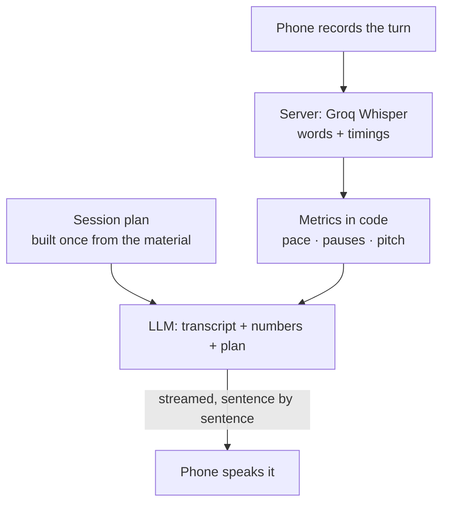
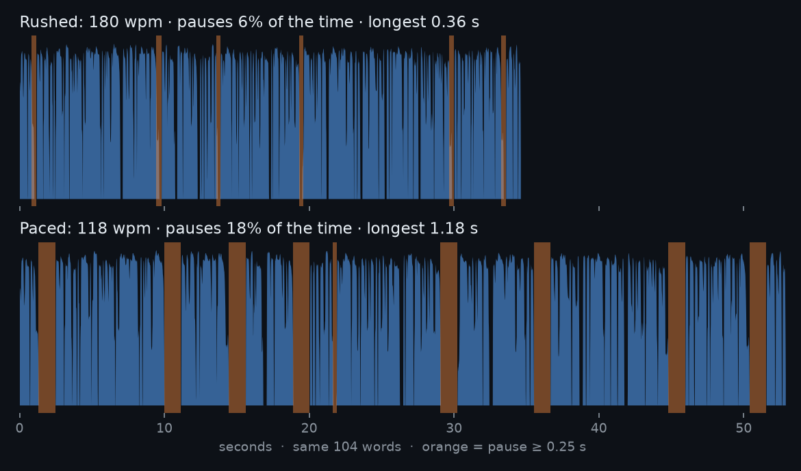
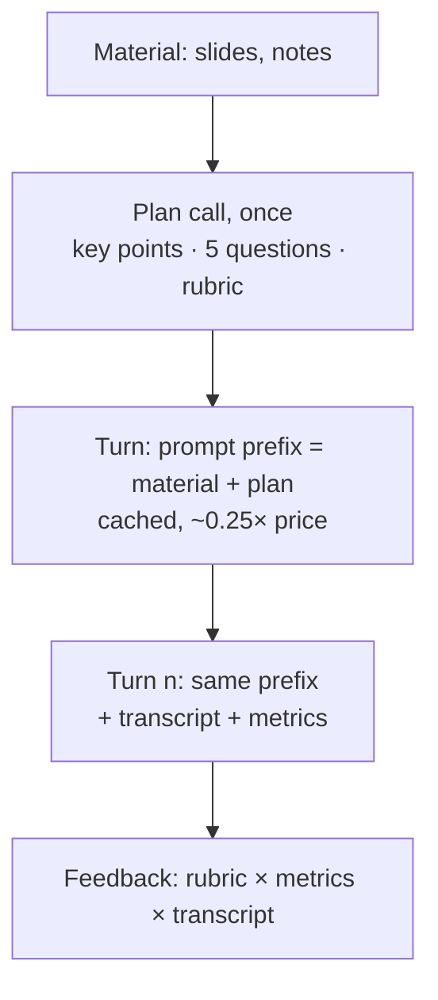
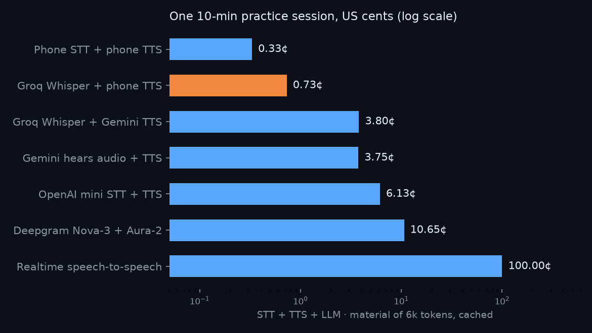

# Under a cent per session: transcribe with timings, measure in code, coach with the model

2026-10-30 · RFC · draft · the voice loop of a practice session: STT, speech metrics, the agent, TTS

## Measure the voice in code; spend the model on coaching

> [!IMPORTANT]
> Record each turn on the phone, transcribe it with word timings (Groq
> Whisper, $0.04 an hour), compute pace, pauses and pitch in plain code,
> and give the model the transcript, the numbers and a plan built once from
> the person's material. The phone speaks the answer, sentence by sentence.
> About **0.7¢ for a 10-minute session**, against ~$1 for a realtime
> speech-to-speech model, and the feedback rests on numbers, not on a
> model's impression of a voice.

- **Do:** voice turns over the existing chat route; metrics as code; a
  session plan from the material; stream the reply.
- **Not needed:** a realtime voice model, RAG, a paid TTS, storing audio.
- **You decide:** the STT provider, the agent's voice, where metrics run.

## Today the assistant is text-only, blocking, and capped at 4 minutes

| What | Where | For a voice coach |
|---|---|---|
| Typed text only, no audio anywhere | [`assistant_page.dart:95`](../../../app/lib/assistant/assistant_page.dart#L95) | the core input is missing |
| One message ≤ 4,000 chars | [`assistant.controller.ts:25`](../../../server/src/assistant/assistant.controller.ts#L25) | a talk past **~4 min at 150 wpm** is refused ([data](data/transcript_fit.csv)) |
| The whole reply before any of it shows | [`openrouter.client.ts:149`](../../../server/src/assistant/openrouter.client.ts#L149), no `stream` | the wait is the full generation |
| Cost and cache hits read, then dropped | [`assistant.service.ts:48`](../../../server/src/assistant/assistant.service.ts#L48) | nobody sees what a session costs |
| A two-line generic prompt | [`assistant.service.ts:53`](../../../server/src/assistant/assistant.service.ts#L53) | no material, no plan, no rubric |

What already fits: the server keeps nothing and the app sends the whole
conversation each turn, so a richer turn (transcript + metrics) needs no new
storage; `usage.cachedTokens` is already parsed, ready for prompt caching.
None of the voice path has tests, because none of it exists.

## Example: the same 104 words, rushed and paced

| | Rushed | Paced |
|---|---|---|
| Pace | **180 wpm** | 118 wpm |
| Time in pauses | 6% | **18%** |
| Longest pause | 0.36 s | 1.18 s |
| Analysis time, no API | 0.20 s | 0.30 s |

Two takes of a one-minute pitch, made with macOS `say` (pt-BR voice),
measured by [`code/speech_metrics.py`](code/speech_metrics.py): 150 lines of
numpy, loudness for pauses, autocorrelation for pitch. The pitch spread came
out equal (4.4 semitones) because it is one synthetic voice: tone is judged
against the person's **own** first takes, not a universal norm.

> [!TIP]
> **Measure with code, judge with the model.** Pace and pauses are
> arithmetic on timestamps; a model asked "was that rushed?" guesses.
> *For us:* the LLM gets `180 wpm, pauses 6%` and turns it into advice.

## The phone's free recogniser stops at the first long pause

| Free on-device option | Limit | Source |
|---|---|---|
| `speech_to_text`, iOS | "a one-minute limit on audio duration" | Apple, quoted on [pub.dev](https://pub.dev/packages/speech_to_text) |
| `speech_to_text`, Android | stops after a pause, "none … longer than 5 seconds" | same page |
| Web Speech API | "only some browsers" | same page |
| `flutter_tts` (speaking) | none that matters: iOS, Android, web | [pub.dev](https://pub.dev/packages/flutter_tts) |

The package says its target is "commands and short phrases, not continuous
spoken conversion". A rehearsal is minutes long and its pauses are what we
measure, so the free recogniser fails on exactly our input. Speaking is
different: the phone's own TTS is free and fine to start with.

So: **record audio on the phone, transcribe on a server.** Recording a
file has no time limit, and one upload per turn is the whole protocol.

## Whisper writes the speech you meant; the audio keeps the "é…"

| Signal | From | Catches |
|---|---|---|
| Words with timings | Groq Whisper | pace, gaps between words |
| Fillers it wrote | the transcript | "tipo", "né", when kept |
| **Voiced time with no word** | loudness × timestamps | "ééé", "hum" Whisper dropped |
| `filler_words` flag | Deepgram | English only ([docs](https://developers.deepgram.com/docs/filler-words)) |

- Whisper-style models output clean text, so fillers tend to vanish:
  CrisperWhisper had to be fine-tuned "to produce more verbatim speech
  transcriptions" ([Wagner et al., Interspeech 2024](https://arxiv.org/abs/2408.16589)).
- Groq's `prompt` "guides the model's style"; a prompt written with fillers
  may keep them: common advice, **not documented**, to test on real takes.
- Loudness says "sound here", the timestamps say "no word here": that is
  hesitation, counted without any vendor's help.

## Speak the first sentence, not the whole answer

| Step after the person stops | Short answer (20 s) | Whole talk (4 min) |
|---|---|---|
| Upload the recording (Opus) | ~0.2 s | ~1 s |
| Groq Whisper (~216× realtime) | ~0.3 s | ~1.1 s |
| Metrics in code | < 0.1 s | ~0.3 s* |
| LLM to its first sentence, streamed | ~0.6 s | ~0.8 s |
| Phone TTS starts | ~0.1 s | ~0.1 s |
| **Until the agent speaks** | **~1.3 s** | **~3.3 s** |

Estimates from vendor figures (*measured on a Mac; slower on the Pi, not
measured). A natural agent aims for **P50 under 800 ms** to first audio;
the biggest lever is feeding LLM tokens to TTS sentence by sentence
([ElevenLabs](https://elevenlabs.io/blog/voice-agent-latency-optimization)).

> [!TIP]
> **Time to first audio, not time to answer.** Stream and speak sentence
> one while sentence two is written. *For us:* after a 4-minute talk, a
> pre-built "Boa! Deixa eu ver seus números…" covers the 3 s honestly.

## Build the session from the material once, before the talk

- A 20-slide deck is ~6k tokens: it fits in the prompt. **No RAG** until
  materials outgrow the context.
- The plan holds the "pre-built" part: questions on the subject, what a
  good answer must cover, how feedback is structured. Each turn picks from
  it instead of inventing, so it is faster and stays on topic.
- Material + plan first and unchanged across turns is what makes the
  prefix cacheable; the client already reads `cachedTokens`.
- Short acknowledgements ("Entendi.", "Continua…") are fixed phrases in
  the app, spoken instantly, never generated.

> [!TIP]
> **Precompute what you can predict.** Questions about known material are
> known before the talk starts. *For us:* one plan call per session, then
> each turn is a pick plus a short reaction.

## The change: five pieces, all on existing seams

| Piece | Where | Size |
|---|---|---|
| Record a turn (Opus/AAC), send it | app: `assistant/` + a recorder package | M |
| `POST /api/assistant/voice`: audio → Groq → metrics → LLM, streamed | server: `assistant/` | M |
| Metrics in TypeScript (port of `speech_metrics.py`) | server: `assistant/speech-metrics.ts` | S |
| Session plan from material, a structured prompt | server: `assistant.service.ts` | S |
| Speak sentences as they arrive; fixed phrases | app: `flutter_tts` | S |

Plus: the audio is discarded after the turn (nothing stored, as today); the
4,000-char cap moves to a duration cap (e.g. 10 min); cost per turn goes to
the server log; the write route gets its row in `analytics/events.ts`.

## The recommended pipeline costs 0.7¢ per session

Session: 6 min of the person, 6 turns, ~2,400 chars spoken by the agent,
6k-token material cached ([`code/session_cost.py`](code/session_cost.py),
[data](data/session_cost.csv)). 100 people × 20 sessions a month: **~$15**
with phone TTS, ~$76 with a cloud voice, ~$2,000 realtime.

## Realtime voice models pay for duplex a rehearsal never uses

| Option | Gain | Cost / session | When it wins |
|---|---|---|---|
| **Groq Whisper + phone TTS** | cheapest that works; word timings | 0.7¢ | now |
| Groq + Gemini Flash-Lite TTS | a better, consistent voice | 3.8¢ | if device voices sound robotic |
| Gemini hears the audio | one call; "hears" tone | 3.8¢ | as a second opinion on tone, later |
| OpenAI mini STT + TTS | one vendor, steerable voice | 6.1¢ | never cheaper here; mini-transcribe shuts down 2027-02 |
| Deepgram Nova-3 + Aura-2 | fast, $200 free credit | 10.7¢ | English fillers only |
| Realtime speech-to-speech | interrupts, lowest latency | ~100¢ | a live debate mode, not rehearsal |

A rehearsal is **half-duplex**: the person talks for minutes, then the agent
answers. Realtime models pay for full duplex we do not use and give no word
timings.

## Impact: a free tier is affordable, and talks have no cap

| | Today | After |
|---|---|---|
| Input | typed text | the voice, any length (cap ~10 min) |
| Cost / session | not recorded | **~0.7¢**, logged per turn |
| 100 people × 20 sessions | — | **~$15 / month** |
| To the agent's first word | the whole reply | ~1.3 s short answer, ~3.3 s whole talk (est.) |
| Feedback rests on | a model's impression | pace, pauses, filler time vs own baseline |

The LLM is half the session's cost, so prompt caching matters more than
the STT price. It also unlocks the material-driven agent of the issue's
points 1–3.

## Decisions

| Decision | Options | Recommended | Cost of the other |
|---|---|---|---|
| STT provider | Groq Whisper turbo · OpenAI mini · Deepgram | **Groq** | 4–8× the STT price; Deepgram's fillers are English only |
| The agent's voice | phone TTS · Gemini Flash-Lite TTS | **phone TTS first**, cloud behind a flag | 5× the session cost |
| Where metrics run | server (TS) · phone (Dart) | **server**: the audio goes there anyway | two codebases to keep equal |
| Keep the audio | discard after the turn · store for replay | **discard** | storage, consent, retention |
| Pace norms | the person's own baseline · fixed wpm bands | **own baseline**, bands as hints | pt-BR speakers measured at a median ~87 wpm in one vendor's data; English bands mislead |

## Decided unattended

- Phases 1–3 only; the deep-research pass (Phase 4) waits for a request.
- Prices were read on vendor pages on 2026-10-30; the realtime figure is
  OpenAI's 2025 estimate, **unverified**. The latency table is estimated.
- The samples are synthetic (`say`, voice Luciana): they prove the method,
  not thresholds for a real voice.
- Session assumptions (6 min of speech, 6 turns, 6k tokens of material)
  live at the top of `session_cost.py`.
- The fixed phrases ("Entendi.", "Boa! Deixa eu ver seus números…") go in
  `app_pt.arb` like every other string.
- **Open question:** which platform comes first (web or phone)? Recording
  and the browser's voices differ; the recommendation holds for both.

## Go deeper

| Idea | The case here | Read |
|---|---|---|
| Measure with code, judge with the model | 180 vs 118 wpm from 150 lines of numpy | [Wagner et al. 2024](https://arxiv.org/abs/2408.16589) |
| Time to first audio, not time to answer | stream sentences; pre-built acknowledgement | [ElevenLabs latency guide](https://elevenlabs.io/blog/voice-agent-latency-optimization) |
| Precompute what you can predict | one plan call per session; a cached prefix halves the LLM cost (0.33¢ vs 0.64¢) | [`code/session_cost.py`](code/session_cost.py) |

Sources:

- [Groq speech-to-text](https://console.groq.com/docs/speech-to-text): $0.04/h, word timestamps, 10 s minimum, 25 MB free tier.
- [Deepgram pricing](https://deepgram.com/pricing): Nova-3 multilingual $0.0052/min, Aura-2 $0.030/1k chars, $200 credit.
- [Deepgram filler words](https://developers.deepgram.com/docs/filler-words): English only.
- [Gemini audio](https://ai.google.dev/gemini-api/docs/audio): 32 tokens per second of audio.
- [Gemini pricing](https://ai.google.dev/gemini-api/docs/pricing): Flash-Lite $0.30/M audio in, Flash-Lite TTS $6/M out to 2026-12-31.
- [OpenAI file transcription](https://developers.openai.com/api/docs/guides/speech-to-text): prompting; `gpt-4o-mini-transcribe` deprecated, shutdown 2027-02-26 (its ~$0.003/min is from third-party pages).
- [speech_to_text](https://pub.dev/packages/speech_to_text), [flutter_tts](https://pub.dev/packages/flutter_tts): on-device limits.
- [VirtualSpeech speaking rates](https://virtualspeech.com/blog/average-speaking-rate-words-per-minute): 120–160 wpm advice; pt-BR median 86–87 wpm in their data (vendor data).
- [CrisperWhisper](https://arxiv.org/abs/2408.16589): verbatim transcription, fillers, timestamps.

Data and code: [`data/takes.jsonl`](data/takes.jsonl),
[`data/session_cost.csv`](data/session_cost.csv),
[`data/transcript_fit.csv`](data/transcript_fit.csv);
[`code/make_samples.sh`](code/make_samples.sh) →
[`code/speech_metrics.py`](code/speech_metrics.py),
[`code/plot_takes.py`](code/plot_takes.py),
[`code/session_cost.py`](code/session_cost.py) (numpy, matplotlib).
